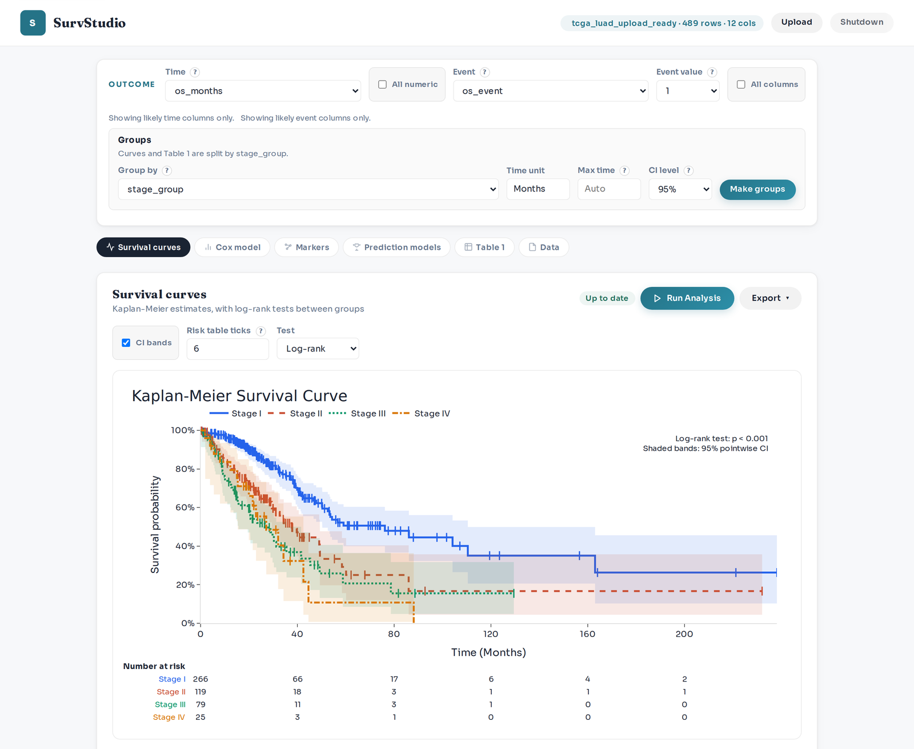

# SurvStudio

**Survival curves, risk factors and ML/DL model comparison in your browser.**
Upload a patient table or choose a sample, run an analysis, and save the results.
A local installation keeps your data on your computer.



[Beginner walkthrough](docs/getting-started.md) · [See all screenshots](docs/screenshots.md) · [User guide](docs/user-guide.md)

## 1. Install

Install [uv](https://docs.astral.sh/uv/getting-started/installation/) once; it also downloads Python for you.

<details>
<summary><strong>Windows — open PowerShell</strong></summary>

```powershell
powershell -ExecutionPolicy ByPass -c "irm https://astral.sh/uv/install.ps1 | iex"
```

Close PowerShell and open it again.

</details>

<details>
<summary><strong>macOS / Linux — open Terminal</strong></summary>

```bash
curl -LsSf https://astral.sh/uv/install.sh | sh
```

Close Terminal and open it again. On an Apple silicon Mac, install Apple's command-line tools with
`xcode-select --install` if they are not already installed.

</details>

Then install SurvStudio, including ML/DL models:

```bash
uv tool install --python 3.12 "survstudio[all] @ https://github.com/kangk1204/SurvStudio/archive/refs/heads/main.zip"
```

[Other install options and troubleshooting](docs/installation.md)

## 2. Run

```bash
survstudio
```

Open **http://127.0.0.1:8000**. Keep the terminal open while using the app; press **Ctrl+C** to stop.
Choose **Synthetic demo** to try it first. For your own file, use one row per patient and include
follow-up time and an event column (`1` = event, `0` = censored).

## 3. Prepare your own data

Use **one row per patient**, with column names in the first row. Save as **CSV** or **Excel (.xlsx)**.

```csv
patient_id,os_months,os_event,age,stage
P001,12.4,1,67,III
P002,18.0,0,59,II
P003,7.2,1,72,IV
```

`os_months` is the time to the event or last follow-up. `os_event = 1` means the event occurred;
`0` means it was not observed before follow-up ended (censored). This small table shows the format;
use a full cohort to fit models. Keep time units consistent and use only information available when
making the prediction. Do not select patient IDs, follow-up time or outcome-derived fields as predictors.

[Mode settings and how to read results](docs/user-guide.md#main-analyses) ·
[Data preparation, missing values and common mistakes](docs/getting-started.md#prepare-your-own-file)

## 4. Choose a mode

| Mode | What it does | What you get |
|---|---|---|
| **Survival curves** | Compare survival between groups | Kaplan–Meier curves, median survival, log-rank test |
| **Risk factors (Cox)** | Examine risk factors together | Hazard ratios, confidence intervals, model checks |
| **Compare models — ML** | Learn and compare risk predictions | Cox baseline, LASSO-Cox, survival forests and boosting; held-out C-index |
| **Compare models — DL** | Evaluate neural survival models | DeepSurv, DeepHit, MTLR; Transformer/VAE are experimental |
| **Markers** | Screen prognostic candidates beyond clinical factors | Adjusted evidence, selection stability and analysis status |
| **Table 1** | Describe the patients | Overall or grouped summary table |

Use **Save results** to export the current result. **More analyses** opens Markers and Table 1.
Uploads and completed results are saved automatically on the server. Use **Saved work** to reopen them after a restart.
[Saved work and backups](docs/saved-work.md)
Earlier interfaces use **Cox model**, **Prediction models** and an **Export** menu.
[Follow one example through curves, Cox and ML/DL](docs/getting-started.md#try-one-example-from-start-to-finish)

## 5. Read the results

| Result | Plain meaning |
|---|---|
| **Survival curve / median** | How long patients remain event-free; a median is unavailable if the curve never reaches 50%. |
| **Hazard ratio (HR)** | Association with the event rate: above 1 is higher, below 1 is lower, relative to the stated reference or unit. |
| **Held-out C-index** | How well a model ranks risk in patients kept out of that fit. Higher is better; 0.50 is chance-level ranking, not “50% accuracy.” |
| **Feature importance** | Which inputs influence the fitted predictions; it does not establish a cause. |
| **Warning / unavailable value** | Read the reason before drawing a conclusion. A missing result is not zero. |

ML/DL compares **risk prediction**, while Cox reports **adjusted associations**. DL is not automatically
better than ML. Compare the same inputs and evaluation splits; small score differences do not establish a winner.
Markers supports candidate assessment and locked external evaluation; an internally stable candidate
is not an independently validated biomarker.

[ML/DL interpretation](docs/getting-started.md#understand-mldl-results) ·
[Common option combinations](docs/getting-started.md#choose-an-option-combination)

## 6. Try the test data

Click a sample on the start screen, or download a CSV below and upload it.

| Sample | Patients | Time / event columns | Try grouping by |
|---|---:|---|---|
| [Synthetic demo](examples/synthetic_demo.csv) | 360 | `os_months` / `os_event` | `stage` |
| [Lung cancer — TCGA-LUAD](examples/tcga_luad_nature2014_upload_ready.csv) | 489 | `os_months` / `os_event` | `stage_group` |
| [Breast cancer — GBSG2](examples/gbsg2_jco1994_upload_ready.csv) | 686 | `rfs_days` / `rfs_event` | `horTh` |

Set **Event value = 1**, open **Survival curves**, and click **Draw curves** (or **Run Analysis** in earlier interfaces).
The result includes a curve, a risk table and group summaries.

**Example results:** TCGA-LUAD median survival is about **76, 38, 27 and 27 months** for stages I–IV.
GBSG2 median recurrence-free survival is **1,528 days** without hormone therapy and **2,018 days** with it.
In one GBSG2 holdout run (seed 42), C-index was **0.688 for RSF** and **0.677 for DeepSurv**.
These are sample outputs, not evidence that a treatment causes a difference or that one prediction model is best.

[Exact settings and KM / Cox / ML / DL outputs](examples/results.md) · [Data sources and larger example files](examples/README.md)

## More help

[Beginner walkthrough](docs/getting-started.md) · [Installation](docs/installation.md) · [User guide](docs/user-guide.md) · [Full reference](docs/reference.md) ·
[Numerical checks](docs/validation/numerical_agreement.md) · [Changes](RELEASE_NOTES.md) · [MIT license](LICENSE)
